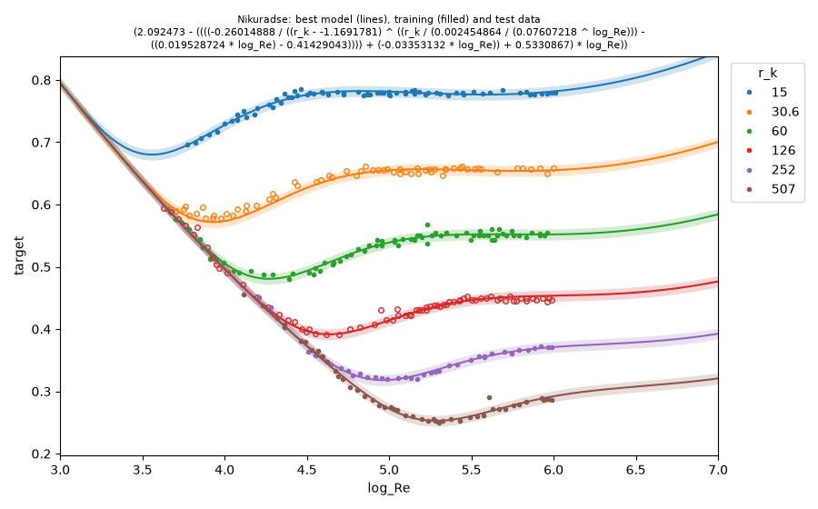
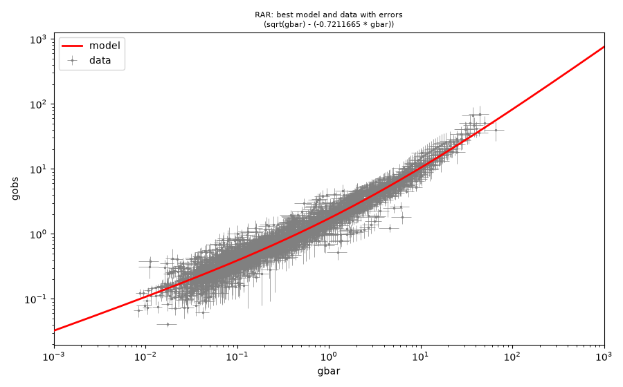
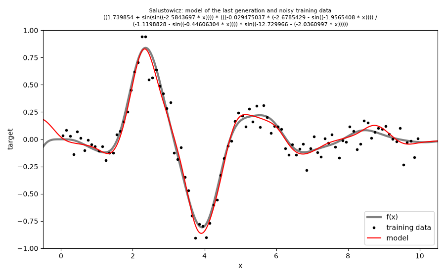

# pyNeoGP

Python bindings to [NeoGP.jl](https://github.com/heal-research/NeoGP.jl), tree-based genetic
programming for symbolic regression.  The bindings expose the Julia API of NeoGP through
[juliacall](https://github.com/JuliaPy/PythonCall.jl): Julia and NeoGP.jl are installed
automatically on first use, and the Julia functions are called from Python as they are called
from Julia.

**The documentation of NeoGP is in the [NeoGP.jl repository](https://github.com/heal-research/NeoGP.jl)**:
the [README](https://github.com/heal-research/NeoGP.jl#readme) (algorithms, likelihoods,
datasets, command line options), the
[quickstart](https://github.com/heal-research/NeoGP.jl/blob/main/QUICKSTART.md) (the examples
below, references of the datasets), and the docstrings of the Julia API.  This README only
describes the use from Python.

## Installation

```bash
pip install "git+https://github.com/heal-research/pyNeoGP"
```

The first `import` installs Julia (if no Julia 1.13 or newer is found), NeoGP.jl and its
dependencies into the Python environment (`<env>/julia_env`) and precompiles them, which takes
a few minutes.  Later imports take a few seconds.

NeoGP.jl requires Julia 1.13, and juliacall runs Julia 1.12 or newer only from a Python that is
linked with OpenSSL 3.5 or newer (`python -c "import ssl; print(ssl.OPENSSL_VERSION)"`).
Otherwise the import fails with "'julia' compat entries have empty intersection".  The Pythons
of [conda-forge](https://conda-forge.org) and Homebrew are linked with a current OpenSSL; many
Linux distributions and the Pythons of `actions/setup-python` on GitHub are not.

## Usage

```python
from pyneogp import neogp
```

returns the Julia module `NeoGP`.  The Julia example of the
[quickstart](https://github.com/heal-research/NeoGP.jl/blob/main/QUICKSTART.md) in Python:

```python
import numpy as np
from juliacall import Main as jl
from pyneogp import neogp

train = neogp.load_dataset(jl.Float32, "examples/data/nikuradse_1_train.csv", "target")
gp = neogp.NSGA2(neogp.create_likelihood("gaussian", train), train.X.shape[1],
                 popsize=500, maxlen=30)
neogp.initialize_b(gp)
neogp.evolve_b(gp, 30)

front = neogp.best_individuals(gp)        # [(individual, (objective1, objective2)), ...]
best, _ = min(front, key=lambda entry: neogp.description_length(entry[0]))
neogp.tostring(best, train.varnames)      # the expression as a string
np.asarray(neogp.predict(best, train.X))  # its predictions
```

- Julia functions ending in `!` are called with the suffix `_b`: `initialize_b`, `evolve_b`, ...
- Arguments are converted to the types NeoGP expects: numpy arrays (and pandas columns) are
  copied into Julia arrays of the same element type, lists become Julia vectors (a list of
  strings a `Vector{String}`), and tuples are converted element by element.
- Return values are Julia objects; vectors support `len`, indexing, iteration and
  `numpy.asarray`.  Errors in Julia raise `juliacall.JuliaError`.
- `help(neogp.NSGA2)` shows the Julia docstring.

Data from numpy:

```python
X = np.random.uniform(1, 5, size=(200, 2))
y = X[:, 0] * X[:, 1] + 0.01 * np.random.normal(size=200)

data = neogp.Dataset(X, y, None, None, ["a", "b"])  # X, y, Xerr, yerr, varnames
gp = neogp.NSGA2(neogp.create_likelihood("gaussian", data), 2, popsize=200, maxlen=20, seed=1,
                 functionset=[neogp.ADD, neogp.SUB, neogp.MUL, neogp.DIV],
                 indiv_loss_func=(neogp.negloglik, neogp.individual_length))
neogp.initialize_b(gp)
neogp.evolve_b(gp, 50, iter_callback=lambda: print(len(neogp.best_individuals(gp))))
```

(`neogp.NSGA2(X, y, ...)` and `neogp.BasicAlgorithm(X, y, ...)` are shortcuts for the Gaussian
likelihood with estimated noise.)  The command line interface of NeoGP is `neogp.main([...])`
with the arguments of NeoGP.jl's `script/runNeoGP.jl`.

## Examples

The scripts in [`examples/`](examples/) are the Python versions of the example scripts of
NeoGP.jl, which are explained in its
[quickstart](https://github.com/heal-research/NeoGP.jl/blob/main/QUICKSTART.md).  They run the
command line interface of NeoGP with the same options, so the Nikuradse and RAR examples find the
same models as in NeoGP.jl (the Salustowicz data are generated with numpy and differ).  Each
script writes the output of the run to `examples/results/<name>.csv` and plots the model of the
last generation over the data with [matplotlib](https://matplotlib.org) into
`examples/results/<name>.png`.  Extra arguments are passed on to the command line interface,
e.g. `python examples/RAR.py --generations 100 --popsize 1000`.  The examples use 4 Julia threads
(`JULIA_NUM_THREADS`) and take a few seconds to half a minute.

```bash
pip install "pyneogp[examples] @ git+https://github.com/heal-research/pyNeoGP"   # matplotlib
python examples/nikuradse_1.py
python examples/RAR.py
python examples/salustowicz.py
```

### Nikuradse data

The friction factor of turbulent flow in rough pipes as a function of the relative roughness
`r_k` and `log_Re`, with a test set of two roughnesses that are not in the training data
([`examples/nikuradse_1.py`](examples/nikuradse_1.py)).  The model of the last generation has
R² = 0.9992 on the training data and 0.9939 on the test data:



The data were used in: Guimerà, R., Reichardt, I., Aguilar-Mogas, A., Massucci, F. A.,
Miranda, M., Pallarès, J., Sales-Pardo, M. (2020). A Bayesian machine scientist to aid in the
solution of challenging scientific problems. *Science Advances* 6(5), eaav6971.
<https://doi.org/10.1126/sciadv.aav6971>.  Here, the training and test split is systematic: three
roughnesses `r_k` for training, two intermediate roughnesses only in the test data.

The original measurements: Nikuradse, J. (1950). Laws of flow in rough pipes. Technical report,
National Advisory Committee for Aeronautics Washington, NACA TM 1292 - Translation of
"Strömungsgesetze in rauhen Rohren" VDI-Forschungsheft 361. Beilage zu "Forschung auf dem
Gebiete des Ingenieurwesens" Ausgabe B Band 4, July/August 1933.

### The radial acceleration relation (RAR)

The observed acceleration `gobs` of galaxies as a function of the baryonic acceleration `gbar`,
both with uncertainties, fitted on a logarithmic scale with a likelihood that marginalizes the
uncertainty of the input and estimates an intrinsic scatter
([`examples/RAR.py`](examples/RAR.py)).  The model of the last generation is
`gobs = sqrt(gbar) + 0.721 * gbar`:



Reference: Desmond, H., Bartlett, D. J., Ferreira, P. G. (2023). On the functional form of the
radial acceleration relation. *Monthly Notices of the Royal Astronomical Society* 521(2),
1817-1831. <https://doi.org/10.1093/mnras/stad597>.  Data provided by H. Desmond.

### Salustowicz function

Noisy samples of the synthetic Salustowicz function `f(x)` (gray) on `x = 0.05:0.1:10`, with
Gaussian noise of 10% of the variance of `f`, generated by the script with numpy; the plot
shows the extrapolation beyond the training data at both ends
([`examples/salustowicz.py`](examples/salustowicz.py)):



The training data (without noise) and the range of the test data are as in: Vladislavleva,
E. J., Smits, G. F., den Hertog, D. (2009). Order of nonlinearity as a complexity measure for
models generated by symbolic regression via Pareto genetic programming. *IEEE Transactions on
Evolutionary Computation* 13(2), 333-349. <https://doi.org/10.1109/TEVC.2008.926486>.

### Threads

NeoGP evaluates the population on all Julia threads.  pyneogp starts Julia with one thread per
core (`PYTHON_JULIACALL_THREADS=auto`) unless `PYTHON_JULIACALL_THREADS` or `JULIA_NUM_THREADS`
is set, and with `PYTHON_JULIACALL_HANDLE_SIGNALS=yes`, which juliacall requires for several
threads.  These options take effect only if `pyneogp` is imported before `juliacall`.

The objectives (`indiv_loss_func`) are evaluated on the worker threads, which must not call
Python, so they must be Julia functions, e.g. `neogp.description_length` or a function defined
with `jl.seval`.  `iter_callback` runs on the main thread and can be a Python function.

## Development

Install the bindings in editable mode and run the tests:

```bash
python -m venv .venv
.venv/bin/pip install -e ".[test,examples]"
.venv/bin/python -m pytest
```

By default, juliacall installs NeoGP.jl from GitHub.  To use a local checkout of NeoGP.jl
instead, run `python use_local_neogp.py path/to/NeoGP.jl` first; it changes
`pyneogp/juliapkg.json` to develop NeoGP.jl from the checkout (revert it before committing).

## License

MIT, see [LICENSE](LICENSE).
